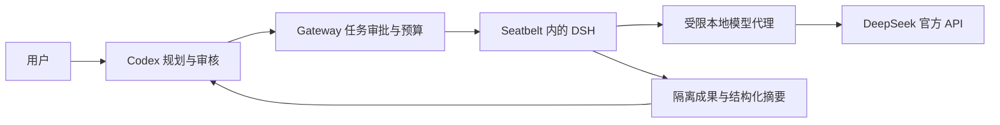

# Codex × DeepSeek Worker

让 Codex 负责规划、审核与交付，让 DeepSeek Harness 承担大量具体执行工作。

一个面向 **macOS** 的按需 Worker Gateway：在用户批准后，将可独立验收的代码生成、测试编写、资料阅读和日志分析委派给 DeepSeek 官方 API；提供任务目录隔离、一次性授权、预算上限和运行记录。**非 OpenAI 或 DeepSeek 官方项目。**

## 解决什么问题

- 将大量阅读、重复代码、测试生成和多轮局部尝试转移给低成本模型。
- 用户继续与 Codex 交互，由 Codex 组织子任务、检查结果、整合到主项目。
- 每次任务使用独立 HOME、DSH_HOME、历史与临时目录，不混入日常 DSH 环境。
- API Key 保存在 macOS Keychain，由父网关持有；DSH 子进程只获得本次代理令牌。
- 默认审批模式、单并发，任务完成即退出，无 GUI、开机自启或常驻服务。

成本是否更低取决于模型价格、任务规模和验收开销，本项目不承诺固定节省比例。普通脚本能可靠完成的任务，优先用脚本。



## 环境要求

- macOS，已实测 Apple Silicon；Intel 和其他 macOS 版本需要自行验证。
- Python **3.9+**、Node.js **24.9+**、npm、Git。
- 可用的 `/usr/bin/sandbox-exec` 和 macOS Keychain。
- 自备 DeepSeek 官方 API Key；如配合 Codex，需自行安装 Codex。

推荐通过 Homebrew 安装 Node。其他 Node 安装位置会自动检测，但自定义动态库布局可能需要调整隔离规则。本项目不提供 Linux/Windows 执行后端，也不会在沙箱失败时自动退回无隔离模式。

## 安装

下载仓库（GitHub 页面 **Code → Download ZIP**，或复制该页面提供的 Git clone 地址），进入项目目录：

```sh
python3 install.py
```

安装到 `~/.local/share/codex-dsh-worker`，命令链接在 `~/.local/bin/dsh-worker`。官方 DSH 版本固定为 `0.2.2-rc.1`，依赖使用仓库锁文件安装，不执行 npm lifecycle scripts。安装过程中会联网下载依赖；不会读取密钥或调用模型。

如命令尚未在 PATH：

```sh
export PATH="$HOME/.local/bin:$PATH"
dsh-worker status
dsh-worker test
```

将 export 行加入你使用的 shell 配置即可长期生效。安装器不会修改 shell 配置、不使用 sudo，也不会覆盖已有的其他 `dsh-worker` 命令或安装全局 `dsh`。

可选自定义：

```sh
python3 install.py --root "$HOME/AgentWorkspace/dsh-worker" --bin-dir "$HOME/.local/bin"
python3 install.py --node /absolute/path/to/node
```

重复安装会更新程序并保留任务、配置与凭据；操作前应停止正在执行的任务。已有运行时可用 `--skip-runtime`，已准备完整 npm 缓存可用 `--npm-cache /path/to/cache --offline`。安装路径支持空格。

### 配置 API Key

推荐使用隐藏输入，密钥不会进入 shell 命令历史或进程参数：

```sh
dsh-worker configure
```

也可从**你指定的文件**读取：

```sh
dsh-worker configure --key-file /absolute/path/to/api-key.txt
```

文件内容仅包含 API Key。成功后存入 Keychain 的 `Codex-DSH-Worker / deepseek-api` 条目，原文件保留，不自动删除。已有不同密钥时拒绝静默替换。Keychain 失败时默认停止；只有显式加 `--allow-file-fallback` 才允许 0600 文件后备存储。Key 不传给普通任务，不写入日志、AGENTS 或 Git。

`status` 和 `test` 不进行模型调用；配置成功也不代表网络/账户余额已验证，第一次已批准的任务会完成真实 API 验证。

## 与 Codex 配合

可在安装时明确选择追加全局规则：

```sh
python3 install.py --skip-runtime --with-codex-rules
```

安装器使用 `CODEX_HOME/AGENTS.md`（默认 `~/.codex/AGENTS.md`），保留原内容，追加前备份，不重复追加本项目已有规则。建议开启新 Codex 对话，确保加载新规则。

如果不想改全局配置，可将安装目录 `docs/codex-rules.local.md` 的内容加入项目 AGENTS.md。规则模板见 [docs/codex-rules.md](docs/codex-rules.md)。

之后可以对 Codex 说：

> 用 DSH 给这个模块补充边界测试。限定 12 次 Flash 请求、每次最多 4096 输出 Token、5 分钟内完成。你审查后再整合。

明确要求使用 DSH，表示授权该指定范围，无需重复询问。Codex 主动推荐时，必须先说明任务、理由、费用/预算与权限，等待用户明确批准；可以批量批准列出的子任务，不能扩展到其他任务。

## 手动完成第一个任务

以下示例会在最后一步产生 DeepSeek API 费用，请先检查任务与预算：

```sh
TASK_ID=$(dsh-worker create --request examples/request.md --timeout 300 --max-requests 8 --max-output-tokens 2048)
dsh-worker authorize "$TASK_ID" --dialog
dsh-worker run "$TASK_ID"
dsh-worker logs "$TASK_ID"
```

在真实 macOS 弹窗中 **按回车批准；按 Esc 或点击“拒绝”取消**。只有批准后才运行；未批准、拒绝、过期或已用过的授权都会被拒绝。拒绝后不要执行最后两行。授权有效期为 30 分钟，绑定任务 ID、请求、预算、输入和初始 workspace 内容；内容变化需新建任务并重新确认授权。

输入来自主项目时，先制作已审查的最小脱敏目录，然后增加 `--input /path/to/sanitized-copy`。网关再复制为只读 input，不直接挂载或修改源项目。默认上限为 300 秒、12 次请求、每次 4096 输出 Token、单请求体 2 MiB；最大值分别为 3600 秒、50 次请求、16384 输出 Token。错误最多重试 1 次，仍计入总请求上限。

对于聊天中已经明确批准的任务，可以：

```sh
dsh-worker authorize "$TASK_ID" --user-message /path/to/genuine-authorization.md
```

**这是调度器对授权来源的担保，不是独立身份验证。** 文件必须保存用户真实批准及其任务/预算对应关系；不允许编造。不要将任何示例文字或历史测试授权当作用户批准。更强身份保障需要外部可信审批组件，当前未实现。

## 查看、取消与清理

| 命令 | 功能 |
|---|---|
| `status` / `test` | 查看启用状态 / 本地 CLI 检查，不调用 API |
| `tasks` | 列出任务 |
| `logs <id>` | 查看结果摘要与日志位置 |
| `reject <id>` | 拒绝未运行任务 |
| `cancel <id>` | 取消任务；已提交 API 请求仍可能计费 |
| `disable` / `enable` | 停止新任务并通知在途任务取消 / 恢复审批模式 |
| `recover` | 在无活动监督器时收敛中断状态并谨慎清理匹配进程 |
| `clean` | 预览超过 7 天终态任务的临时数据清理 |
| `clean --execute` | 清理 tmp 和 HOME/.cache，保留成果、历史、日志与审批证据 |

程序退出码：0 成功；1 任务运行失败/取消/超时；2 网关拒绝、参数或配置问题。`completed` 仅表示模型会话正常结束，**不代表工作已经验收**。

## 结果与费用

每个任务目录包含 request.md、spec.json、status.json、只读 input、可写 workspace、独立 home/tmp，以及：

- `output/summary.json`：主要结果、文件、测试、问题与待处理事项。
- `output/result.json`：运行状态、最终事件、文件列表；默认需要 Codex 审核。
- `output/metrics.json`：模型请求、输入/输出/缓存 Token、重试与时长。
- `logs/events.jsonl`、`logs/stderr.log` 和 `home/.dsh/sessions/`：详细证据，按需阅读。

只支持 `deepseek-flash`，默认关闭 thinking，不自动切换更贵模型，不启用搜索/抓取/文件上传接口。实际账户扣款无法取得时为 `null`，不能把 Token 估算当作账单。价格估算默认关闭；要开启，按 [官方价格](https://api-docs.deepseek.com/quick_start/pricing/) 更新安装目录 config/pricing.json，并设置到期时间，格式见 [价格模板](docs/pricing.example.json)。模板不是当前报价，峰/谷规则变化时还需更新估算器。

## 权限边界

外层 Seatbelt 从 deny default 出发，限制 DSH 宿主及后代：只能读取任务文件与系统/运行依赖；只能写 workspace/home/tmp；只能连接本任务的本地模型代理端口。父网关持有真实 API Key，通过 HTTPS 调用 DeepSeek。子进程不继承主机 API/云凭据环境。

为避免 macOS 嵌套沙箱失败，DSH 内层使用 `danger-full-access`，**仅在外层 Seatbelt 强制隔离内有效，严禁脱离网关复用该模式**。没有可用的 Seatbelt 时任务失败。

这不是 VM 或独立系统账户：允许系统目录、Homebrew 运行依赖、广泛文件元数据读取和进程创建。不能抵抗同一用户修改网关/收据、GUI 自动化、系统漏洞或所有进程组逃逸；禁用内置子智能体工具也不等于能阻止任意脚本模拟其他智能体。不要用它执行敌对代码。完整边界见 [SECURITY.md](SECURITY.md)。

## 开发与测试

Python 端只使用标准库；不需要调用真实 API：

```sh
PYTHONDONTWRITEBYTECODE=1 python3 -m unittest discover -s tests -v
```

测试覆盖审批内容与生命周期、预算、模拟 API 错误、超时、取消、异常输出、进程清理，以及真实 macOS 文件/符号链接/网络隔离。弹窗适配在自动测试中使用模拟响应；真实点击和模型调用必须由用户显式启动。隔离测试需要可施加 Seatbelt 的 macOS 环境；在另一个受限沙箱内可能无法运行。

原始部署已验证过真实 API、代码生成、Python 执行、用户批准/拒绝和授权不可复用。公开版在干净目录进行安装及离线自动化回归；真实用户任务、账单、密钥和个人机器报告均不包含在仓库中。不声称已覆盖所有 macOS/Node 组合。

## 更新与卸载

更新：拉取源码后重新运行 install.py，默认保留本地任务与配置；审查上游 DSH 新版后再有意更新 runtime-deps 的版本和锁文件。

卸载：先 disable 并确认没有在途任务，再删除自己选择的命令链接和安装目录；如需保留记录先备份 tasks。Keychain 条目和追加的 AGENTS 区块不会自动删除，需要由用户自行决定。不要将本机运行目录加入源码仓库。

## 项目范围

已实现审批网关、独立副本、按需 Headless、单并发、预算、取消/超时、有限重试、摘要与用量。未实现原生 Codex 不可伪造审批桥、VM/独立账户、自动 Git worktree/合并、多 Worker、ACP 或管理 GUI。

基于官方 [DeepSeek Harness](https://github.com/deepseek-ai/deepseek-harness)，采用其 [Headless CLI](https://github.com/deepseek-ai/deepseek-harness/blob/master/packages/bundle/headless/README.md)。官方 Harness 仍为开发预览版，可能出现兼容变化。

本项目使用 [MIT License](LICENSE)。DSH 及其依赖由安装器独立下载，适用各自许可证。
